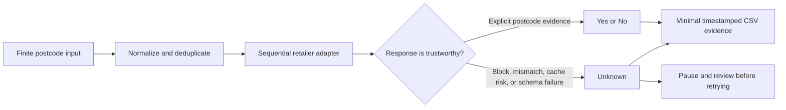

# Responsible Data Collection and Research Ethics

## Status of this document

This document records the safeguards, boundaries, and known limitations of
`grocery-delivery-availability`. It is part of the research method: a software
release should not be described as reproducible without also stating how live
collection was constrained.

These safeguards are not permission to collect. Before each run, the operator
must independently review the research purpose, institutional requirements,
current retailer terms and robots guidance, applicable law, expected traffic,
and data-retention plan.

## Ethical design principles

The tool follows five principles:

1. **Necessity:** request only the evidence needed to classify postcode-level
   delivery availability.
2. **Proportionality:** use a finite postcode list, sequential execution, and a
   documented interval instead of unrestricted discovery crawling.
3. **Uncertainty preservation:** technical failure is `Unknown`, never evidence
   of non-delivery.
4. **Data minimisation:** do not collect customer accounts, orders, payments,
   baskets, personal addresses, or full product catalogues.
5. **Provider feedback:** treat blocks and rate limits as instructions to pause
   and review the run, not as obstacles to evade.

## Collection boundary

The unit of observation is one supplied UK unit postcode at one UTC timestamp.
The software does not enumerate postcodes from retailer websites. Input should
come from a documented reference source and should not be derived from customer
or household records.

Retailer adapters make different minimum request sequences because the public
storefronts expose different evidence:

| Retailer | Typical postcode-specific evidence path | Minimisation decision |
|---|---|---|
| Amazon Fresh | Select postcode, wait for session state, read delivery-available brand cards | Retain brand names only; do not crawl products |
| Chop Chop | One postcode lookup | Retain only the serving-store name |
| Co-op | Reuse one storefront session, then set the postcode | Separate geographic coverage from current slots |
| Iceland | Reuse one storefront session, then request the boolean delivery status | Retain the explicit decision only |
| Ocado | Resolve one address candidate, verify its returned postcode, request deliverability | Do not collect the returned address text |
| Morrisons | Resolve and verify the postcode, bind a temporary destination, then request a one-item catalogue check | Use the smallest catalogue response that can detect an empty location |

Counts vary when a session is created or rotated, and the retailer interfaces
are undocumented. Morrisons has the largest request chain; a successful check
may require roughly seven API calls. This cost must be considered when setting
run size and pacing.

## Control path

## Safeguards implemented in the software

- The default runner is sequential and waits `1.5 seconds` after each completed
  postcode check, or `2 seconds` for Co-op.
- Browser-backed adapters reuse a session rather than reopening and reloading a
  complete storefront for every postcode.
- Input postcodes are normalised and deduplicated before live requests.
- Atomic checkpoints reduce the need to repeat completed work after an
  interruption.
- Resume mode reuses prior `Yes` and `No` results. After a block or systemic
  failure, `--keep-unknown` prevents automatic retries of existing `Unknown`
  rows while the cause is investigated.
- Returned postcodes are compared with requested postcodes whenever the source
  exposes that evidence.
- Morrisons adds a unique request token and no-cache headers; a reported cache
  hit is `Unknown` rather than accepted as evidence for the new postcode.
- Amazon Fresh waits for address state to settle before reading brand cards.
- Invalid addresses, HTTP failures, blocks, timeouts, response changes, and
  suspected stale state remain `Unknown`.
- Co-op checkpoints and stops on 403/429, a postcode mismatch, or an unknown
  coverage schema. It does not automatically retry after an access-control
  response.
- Live retailer traffic is absent from the default automated test suite.

## Important limits of version 0.1

The current runner is designed for bounded, supervised, single-process
research collection. Its delay separates completed postcode checks; it does
not enforce a minimum gap between every internal request in a multi-request
adapter. It also has no distributed global limiter or shared 429 circuit
breaker.

Consequently:

- do not run several local processes, browser contexts, machines, or cloud
  workers against the same retailer concurrently;
- do not interpret the configurable delay as evidence that any request rate is
  accepted by a retailer;
- do not start an unattended national run without a retailer-specific soak
  test, monitoring, and explicit stop conditions; and
- a future parallel or cloud implementation must add one shared request-start
  limiter and a shared block/rate-limit circuit before it is considered a
  responsible production configuration.

Direct HTTP adapters currently use browser-compatible request headers for
storefront compatibility rather than a named research User-Agent. This is a
documented limitation to review before repeated public deployment.

## Stop and retry policy

Operators should define thresholds before a run begins. At minimum:

- stop immediately on HTTP 429 and respect `Retry-After` when supplied;
- pause on HTTP 403, Imperva/Incapsula, Akamai, CAPTCHA, login, or other
  access-control responses;
- stop on repeated 5xx responses, timeouts, or a sudden cluster of `Unknown`;
- stop when returned postcodes do not match requested postcodes;
- stop when response schemas or decision fields change; and
- inspect the latest checkpoint before deciding whether any retry is justified.

The project does not use CAPTCHA solving, credential automation, proxy or IP
rotation, residential proxy networks, fingerprint spoofing, or security-control
evasion. A different network must not be used merely to continue traffic after
a provider has rejected the run.

The Co-op retests illustrate this rule. On 1 and 12 October 2026, the storefront
could render but Imperva blocked session initialisation or postcode submission.
Those observations remained `Unknown` and testing stopped. A later normal Edge
session became usable without bypassing the control. Collection then remained
single-process and sequential, used approximately two seconds between postcode
checks, restarted the browser only at bounded batch boundaries, and paused for
20 minutes after a 403 before any supervised recheck. No proxy, IP rotation,
CAPTCHA service, cookie export, or fingerprint spoofing was used. The established
browser profile and complete responses are not part of this repository.
The released adapter supports attachment to that operator-controlled Edge
session, but never reads, copies, or exports its cookies or browser profile.

## Result semantics and research integrity

`Yes`, `No`, and `Unknown` are deliberately separate:

- `Yes` requires the retailer-specific affirmative evidence documented in the
  methodology.
- `No` requires a successful postcode-specific response showing no usable
  service under that retailer's definition.
- `Unknown` covers any case where the software cannot make that inference
  safely.

A missing current slot is not automatically `No`. An unresolved or historical
postcode is not automatically `No`. A blocked request is never `No`. This
conservative classification reduces false claims about geographic exclusion.

The retailers also measure different services: rapid delivery, scheduled
grocery delivery, and Amazon brand availability are not interchangeable.
Results must retain the collection time, software version, retailer definition,
and denominator used in any reported rate.

## Privacy and data governance

Unit postcodes can describe small geographic areas and may become identifying
when linked to people or household records. This tool accepts postcodes as
geographic research units; it must not be used to build individual profiles or
to infer the shopping behaviour of residents.

The public repository contains software, synthetic examples, and method
documentation only. It excludes:

- complete retailer responses and HTML pages;
- browser profiles, cookies, tokens, and session identifiers;
- customer or account information;
- generated postcode results and research datasets;
- operational logs and screenshots; and
- cloud resource names, credentials, and private deployment configuration.

CSV output retains only the decision, reason, HTTP status, endpoint, timestamp,
and narrowly scoped retailer evidence such as Amazon brand names or Morrisons
service modes. If a separate dataset is released, it requires its own metadata,
licence or access terms, disclosure review, and citation; the MIT software
licence does not license retailer content.

## Constrained interface discovery

The adapters were derived by observing network activity generated by public
retailer postcode and address-selection interfaces and by running bounded
validation probes. Discovery was limited to identifying the request already
used for the research signal.

The method does not justify exploring unrelated account, payment, ordering, or
administrative interfaces. Once minimum structured evidence is available, the
tool should not load extra pages or collect broader content merely because it
is technically accessible.

## Auditability and reproducibility

Each output row records the normalized postcode, retailer, three-state result,
reason, UTC timestamp, relevant endpoint, HTTP status when available, and
structured evidence. The software version, input provenance, command-line
parameters, collection network, start/end times, and observed blocks should be
recorded alongside every research run.

Historical success demonstrates what the interface returned at that time; it
does not guarantee current availability or continued endpoint access. Equally,
a later access-control block does not retroactively change a valid historical
response. Dated smoke-test records preserve this distinction.

Each research run should therefore retain, outside the software repository,
its purpose, software version, input provenance and exclusions, collection
parameters, timing, stop conditions, access-control events, result counts,
retention arrangements, and the identity of the archived software release used.

Responsible collection is therefore a versioned and auditable part of the
software, not an informal promise made separately from it.
